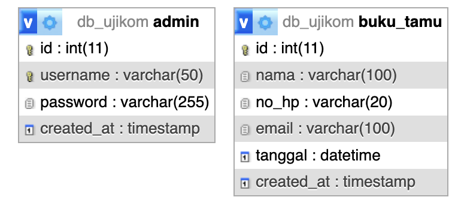

# Dokumentasi Proyek Ujikom: Website Waterboom Cahaya Abadi (Villa Buaya)

Halo Bapak/Ibu Asesor! Selamat datang di repositori proyek Uji Kompetensi (Ujikom) saya. 
Proyek ini adalah sebuah website informasi sekaligus sistem pendataan pengunjung (Buku Tamu) untuk Waterboom Cahaya Abadi yang berlokasi di Kiangroke, Banjaran.

Saya membangun website ini menggunakan **PHP Native, MySQL, HTML5, Vanilla CSS, dan sedikit sentuhan JavaScript (SweetAlert2)** supaya tampilannya interaktif tapi tidak berat di server.
Di bawah ini saya buatkan panduan agar Bapak/Ibu Asesor lebih mudah melihat fitur-fitur yang sudah saya kerjakan, serta alasan teknis kenapa saya menggunakan logic/syntax tertentu di dalamnya.

---

## 1. Struktur Database
Website ini menggunakan dua tabel utama di database `db_ujikom`:
1. **admin**: Menyimpan data akun login (username & password). Passwordnya sudah saya enkripsi lho Pak/Bu, jadi wujud aslinya tidak terlihat di database.
2. **buku_tamu**: Menyimpan data pengunjung yang dikirim dari form halaman depan (seperti nama, no HP, email, dan tanggal).

---

## 2. Entity Relationship Diagram (ERD)

ERD ini menunjukkan struktur database yang kita gunakan (`db_ujikom`).

Deskripsi Tabel:

1. Tabel `admin`:
   - `id`: Primary Key (unik) untuk identitas admin.
   - `username`: Nama pengguna untuk login.
   - `password`: Kata sandi (sudah di-*hash* / dienkripsi).
   - `created_at`: Tanggal pembuatan akun.

2. Tabel `buku_tamu`:
   - `id`: Primary Key untuk setiap baris data pengunjung.
   - `nama`: Nama lengkap pengunjung.
   - `no_hp`: Nomor telepon yang bisa dihubungi.
   - `email`: Alamat surel aktif.
   - `tanggal`: Tanggal rencana kunjungan atau observasi.
   - `created_at`: Tanggal pembuatan data.

---

## 3. Fitur Unggulan & Penjelasan Teknis (Untuk Asesor)

### A. Tampilan Depan (Bento Grid & Glassmorphism)
Kalau Bapak/Ibu perhatikan di halaman `index.php`, penataan layout-nya sengaja saya buat asimetris tapi rapi. Saya menerapkan teknik **CSS Bento Grid** dipadukan dengan efek **Glassmorphism** (kaca buram).
- **Syntax Menarik**: Di dalam `style.css`, Bapak/Ibu akan menemukan `backdrop-filter: blur(16px);`. Syntax ini yang membuat background gambar kolam renangnya tampak tembus pandang tapi nge-blur layaknya aplikasi iOS/Apple modern, jadi tulisan saya tetap sangat jelas dibaca.

### B. Keamanan Login Admin (Password Hashing)
Di sistem login (`cek_login.php`), saya nggak menyimpan password dalam bentuk tulisan mentah seperti "admin123".
- **Syntax `password_hash()` dan `password_verify()`**: Saya pakai fungsi bawaan PHP ini untuk meng-*hash* (mengacak) sandi ke dalam database. Pas admin masuk, PHP nggak ngecek katanya, tapi nyocokin kecocokan rumus *hash*-nya. Ini standar industri Pak/Bu, biar kalaupun databasenya jebol, password sang admin tetap aman ga ketahuan.
- **Syntax `$_SESSION`**: Pas sukses masuk, status admin dicatat dalam memori browser. Jadi gausah bolak-balik login terus menerus selama belum di "Logout".

### C. Validasi Buku Tamu Double-Layer (Ganda)
Ini fitur krusial yang sengaja saya kembangkan biar aman dari user iseng atau bot. Ada 2 lapis keamanan data:
1. **Lapis 1 (Client-side HTML5)**: Saya memasang atribut `min="<?= date('Y-m-d') ?>"` di kalender form, supaya opsi tanggal di masa lalu di-blokir langsung oleh browser.
2. **Lapis 2 (Server-side PHP)**: Walaupun di browser udah diblokir, saya tebelin lagi keamanannya di `simpan.php`. Ini buat jaga-jaga kalau si pengunjung cerdik dan nge-*bypass* validasi HTML pakai inspect element.
   - **Syntax `strtotime()`**: Digunakan untuk mengubah format string tanggal inputan (contoh: '2026-04-15') menjadi *UNIX Timestamp* (hitungan angka detik murni sejak tahun 1970). Gunanya apa? Dengan diubah jadi detik, logika PHP (If-Else) saya jadi bisa menebak dengan mudah: *Apakah detik input < detik hari ini?* Kalau iya, langsung tolak!
   - **Syntax `strlen()`**: Dipakai buat menghitung jumlah (panjang) teks yang diketik. Saya pakai ini buat memastikan bahwa Nomor HP si pengunjung minimal 10 digit angka.
   
### D. Flash Session (Autofill Form Anti Lelah)
Pernah nggak Pak/Bu, lagi ngisi formulir panjang-panjang, pas diklik "Submit" ternyata error, lalu pas balik letak ketikannya pada hilang semua harus *start* dari awal? Nah, pengunjung website saya nggak akan merasakan capek seperti itu.
- **Solusinya**: Saya memanfaatkan `$_SESSION['form_data']`. Sesaat sebelum sistem PHP menendang *(redirect)* user karena salah input tanggal atau no HP, data ketikan mereka saya simpan dulu sekejap ke memory session. Pas halaman ngereload kembali, datanya otomatis dipanggil ulang ke kolom *value* input. Sepersekian detik kemudian session itu langsung saya `unset()` (diluluhlantahkan) biar tidak bocor nempel ke user lain. 
*(Catatan: Khusus kolom password di halaman login, logikanya sengaja saya matikan demi proteksi keamanan).*

### E. Pop-up SweetAlert2 & Anti CSS Scrolling Glitch
Demi menambah estetika, pemberitahuan berhasil dan gagal saya arahkan ke popup eksternal (SweetAlert2). 
- Di file `index.php`, logika JavaScript saya ciptakan secara dinamis. Saya hanya menggunakan 1 blok kode peringatan saja yang bereaksi membaca embel-embel *URL Paremater* (`?error=` atau `?pesan=`).
- Selain itu, saya akali juga dengan perintah `document.documentElement.style.scrollBehavior = 'auto';` lalu memanggil `scrollIntoView()`. Ini berguna banget biar layar komputer bapak otomatis ter-fokus (lompat halus) ke area form yang error tanpa harus buang energi *scroll-scroll* manual pakai mouse.

### F. Pencegahan Serangan SQL Injection & Pengoptimalan Database
Pada semua pengerjaan Database (mulai dari Login hingga Operasi CRUD), saya meningkatkan arsitekturnya ke tingkat keamanan dan standar industri yang optimal!
- **Penggunaan Prepared Statements (`$koneksi->prepare`) & `bind_param`**: Ini adalah praktik yang wajib digunakan di industri pengembangan web modern. Dibandingkan hanya melakukan fungsi lama *"escape string"*, teknik *Prepared Statement* secara teknis memisahkan logika query SQL di mesin server dan nilai data input pengguna ke dalam 2 saluran komunikasi yang sangat berbeda. Jadi sekalipun di bombardir teks jahat peretasan seperti `' OR 1=1 --`, mesin database akan menetralisirnya dan tetap menganggap inputan form tersebut sebaga *Text Text Biasa* bukan sebagai sebuah *Coding*. Celah kebocoran peretasan SQL Injection 100% dipastikan tertutup mutlak.
- **Efisiensi Pengambilan Data dengan Limit & Paradigma Object Oriented**: Skenario seperti mencocokkan *username* admin yang *login* atau membaca *id* saat ditekan *edit*, logika di belakang query SQL sudah saya tingkatkan performanya dengan memakai ujung kunci penutup `LIMIT 1`. Mesin *database* tidak perlu membuang energi komputasi mengecek miliaran baris hingga tabel yang ke bawah. Selain itu gaya kode *fetch* dan *query* nya dipadatkan menjadi gaya *Object Oriented* untuk menghapus beberapa query penugasan komputasi *database* yang ganda. *Code is cleaner & strongly effective!*

---
Kira-kira begitu Bapak/Ibu Asesor alur di balik kode rekayasa perangkat lunak yang saya bangun. Sengaja saya tuliskan detilnya di sini sebagai pengingat.

struktur folder:

ujikom/
├── README.md
├── index.php
├── login.php
│
├── admin/
│   ├── index.php
│   ├── edit.php
│   ├── logout.php
│   └── handlers/
│       ├── cek_login.php
│       ├── hapus.php
│       └── simpan.php
│
├── assets/
│   ├── hero.png
│   └── pool2.png
│
├── config/
│   └── koneksi.php
│
├── css/
│   ├── style.css
│   └── admin_style.css
│
└── sql/
    └── db.sql

    

