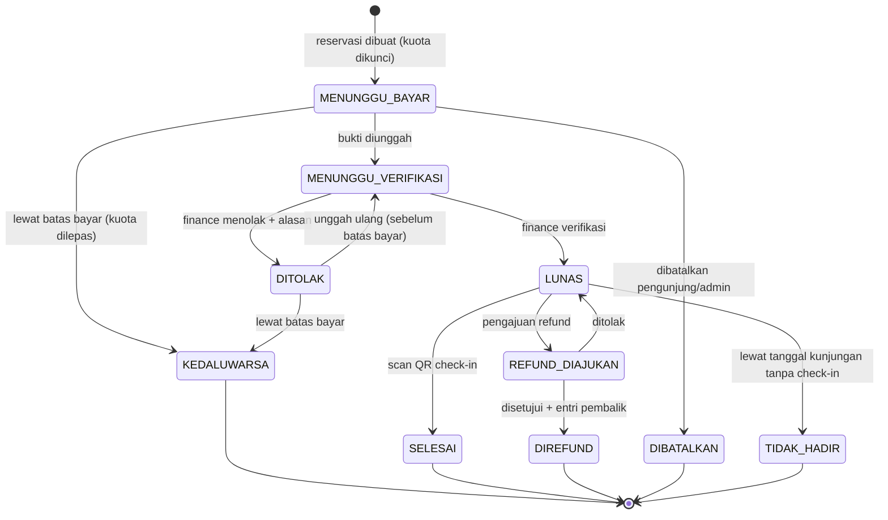

# PRD: Waterboom Cahaya Abadi
**Perapihan Alur Sistem, CRUD Terstruktur, Alur Pembayaran → Kas, dan Kesiapan Audit Keuangan**

| | |
|---|---|
| **Versi** | 1.0 |
| **Status** | Draft untuk disetujui owner |
| **Projek** | Waterboom Cahaya Abadi: Reservasi Tiket & Buku Tamu Digital |
| **Stack saat ini** | PHP 8 native · MySQL/MariaDB (`mysqli`) · FPDF + QR · Fonnte WA · XAMPP |
| **Tanggal** | 21 Oktober 2026 |
| **Dokumen terkait** | `PROJECT_STORY.md`, `docs/audit/`, `tests/verify_hardening.php` |

<!--
🤖 INSTRUKSI UNTUK AGENT
1. Baca dulu `PROJECT_STORY.md`, `docs/audit/`, dan seluruh isi `sql/`, lalu petakan kondisi nyata sebelum mengubah apa pun. PRD ini berisi target; kondisi kode sebenarnya harus Anda verifikasi sendiri.
2. Jangan mengarang. Jika kode berbeda dengan PRD, laporkan selisihnya di `docs/audit/04-gap-analysis.md`.
3. Semua perubahan skema database lewat file migrasi bertingkat (`sql/migration_v3_*.sql`), bisa diulang aman (idempotent) dan punya skrip rollback. Jangan edit data historis.
4. Jangan menjalankan perintah destruktif (DROP, TRUNCATE, hapus data, rotasi kredensial) tanpa konfirmasi owner. Backup dulu.
5. Jangan mencetak data pengunjung asli, nomor rekening asli, token, atau API key di laporan, log, atau commit. Gunakan data dummy dan `[REDACTED]`.
6. Tetap PHP native sesuai keputusan projek. Boleh merapikan struktur, tidak boleh migrasi ke framework.
7. Kerjakan bertahap, satu tema per commit, rujuk ID kebutuhan (mis. `feat(PAY-4): ...`). Tulis tes yang gagal dulu, lalu perbaiki.
8. Aturan akuntansi/pajak yang belum pasti ditandai `TODO: konfirmasi akuntan`, jangan diasumsikan.
-->

---

## 1. Latar Belakang

Projek ini sudah berjalan penuh sebagai prototype dan hasil audit sebelumnya sudah menutup temuan Critical/High (7 PASS / 0 FAIL pada `verify_hardening.php`). Yang masih kurang bukan lagi celah dasar, tetapi **kerapian sistem sebagai alat operasional dan alat pertanggungjawaban uang**:

- Alur status booking dan pembayaran belum didefinisikan sebagai aturan yang tegas (siapa boleh mengubah status apa, kapan, dan apa akibatnya).
- CRUD tersebar di banyak handler dan belum ada peta resmi: entitas apa, siapa boleh apa, hapus fisik atau arsip.
- Pembayaran masih berupa "bukti transfer diverifikasi admin". Belum ada **buku kas** yang mencatat uang masuk/keluar sehingga pertanyaan *"uangnya masuk ke kas yang mana, dan cocok tidak dengan rekening?"* belum bisa dijawab oleh sistem.
- Belum ada kelengkapan **audit keuangan**: rekonsiliasi, tutup harian, laporan, pembalikan transaksi (bukan hapus), dan pemisahan tugas.
- Ada backlog dari audit: guard sesi aktif di scanner & API notifikasi, CSRF di logout & export, dan keputusan pengambilan ulang slot kuota setelah pembayaran ditolak.

**Dalam bahasa awam:** kasir digital sudah bisa menerima pesanan dan mengecek bukti transfer. Sekarang kita buat juga "buku kas dan laci uangnya" supaya setiap rupiah punya jejak, bisa dicocokkan dengan rekening, dan bisa diperiksa auditor tanpa pusing.

---

## 2. Jawaban Singkat: "Pembayaran Langsung Masuk ke Kas?"

**Tidak otomatis.** Dengan model sekarang (transfer manual + upload bukti), uang masuk **langsung ke rekening/e-wallet milik venue, di luar sistem**. Sistem tidak pernah memegang uang. Yang dikelola sistem hanyalah **pencatatan**. Karena itu "masuk kas" harus dirancang sebagai proses pencatatan bertahap:

```
Pengunjung transfer ke rekening venue        (uang pindah di bank, di luar sistem)
        ↓
Upload bukti → status pembayaran: MENUNGGU VERIFIKASI
        ↓
Finance memverifikasi (cek nominal, tanggal, rekening tujuan)
        ↓
Sistem mencatat PEMASUKAN ke Buku Kas (akun: Bank X)   ← "masuk kas" versi sistem
        ↓
Rekonsiliasi dengan mutasi bank (harian/mingguan)
        ↓
Status entri: TERREKONSILIASI  ← uang terbukti benar-benar ada di rekening
```

**Tiga tingkat kepastian uang** (ini yang dilihat auditor):

| Tingkat | Arti | Dibuat oleh |
|---|---|---|
| 1. Diklaim | Pengunjung mengunggah bukti | Sistem (otomatis) |
| 2. Terverifikasi | Petugas meyakini bukti valid, entri kas dicatat | Finance |
| 3. Terekonsiliasi | Nominal & tanggal cocok dengan mutasi bank/e-wallet | Finance + (opsional) Super Admin sebagai pemeriksa |

**Aturan emas:** entri buku kas **hanya dibuat saat pembayaran terverifikasi**, bukan saat bukti diunggah, dan **tidak boleh dihapus atau diedit**. Koreksi dilakukan dengan entri pembalik (reversal).

### Perbandingan opsi pembayaran

| | **Opsi A: Transfer manual + Buku Kas + Rekonsiliasi** *(target PRD ini)* | **Opsi B: QRIS dinamis / payment gateway** *(fase lanjutan)* |
|---|---|---|
| Uang masuk ke | Rekening venue langsung | Saldo merchant gateway → settlement ke rekening (biasanya H+1) |
| Verifikasi | Manual oleh petugas | Otomatis lewat webhook |
| Biaya | Tanpa biaya platform | Ada MDR/fee per transaksi |
| Rekonsiliasi | Manual vs mutasi bank | Otomatis vs laporan settlement |
| Risiko | Salah verifikasi, bukti palsu | Webhook palsu/replay (harus diverifikasi signature) |
| Cocok untuk | Skala venue saat ini | Bila volume naik |

PRD ini mengerjakan **Opsi A** dengan desain yang tetap kompatibel bila nanti pindah ke Opsi B (tabel `payments` punya kolom `method` dan `provider_ref`).

---

## 3. Tujuan (Goals)

| # | Tujuan | Indikator berhasil |
|---|---|---|
| G1 | Alur booking → bayar → tiket → check-in punya **state machine** tegas | Semua perubahan status lewat satu service; transisi ilegal ditolak |
| G2 | CRUD seluruh entitas jelas, konsisten, dan berhak akses terdefinisi | Matriks CRUD (Bagian 6) terpenuhi 100% |
| G3 | Ada **buku kas** yang mencatat semua uang masuk/keluar, append-only | Tiap pembayaran terverifikasi punya tepat 1 entri kas |
| G4 | Pembayaran bisa **direkonsiliasi** dengan mutasi bank | Selisih rekonsiliasi terlihat & bisa dijelaskan |
| G5 | Sistem **siap diaudit keuangan** | Daftar kelengkapan Bagian 8 terpenuhi |
| G6 | Backlog keamanan audit sebelumnya selesai | 3 item backlog tertutup + dites |
| G7 | Struktur kode rapi dan mudah dirawat | Handler per resource, logika di service, tes otomatis |

## 4. Non-Goals

- Tidak migrasi ke framework (Laravel dll.).
- Tidak membangun payment gateway di fase ini (hanya disiapkan kompatibilitasnya).
- Tidak membangun sistem akuntansi penuh (neraca, laba rugi, penyusutan aset). Cukup buku kas, laporan operasional, dan data yang siap diolah akuntan.
- Tidak mengubah desain visual landing page.
- Tidak menggantikan peran akuntan/konsultan pajak. Aturan pajak dan pengakuan pendapatan dikonfirmasi ke ahlinya.

## 5. Pengguna & Peran (RBAC)

| Peran | Tugas utama | Catatan |
|---|---|---|
| **Pengunjung** | Reservasi, bayar, upload bukti, cek booking, unduh tiket, isi buku tamu/ulasan | Tanpa akun; akses lewat kode booking + verifikasi tambahan |
| **Petugas Gerbang** (`gate`) | Scan QR check-in | Hanya scanner; tidak bisa lihat data keuangan |
| **Finance** (`finance`) | Verifikasi pembayaran, kelola buku kas, rekonsiliasi, tutup harian, laporan | Tidak boleh mengelola akun admin |
| **Admin Operasional** (`admin`) | Kelola booking, kuota, harga, berita, ulasan | Tidak boleh verifikasi pembayaran sendiri (lihat SoD) |
| **Super Admin** (`super_admin`) | Kelola akun & izin, lihat audit log, setujui reversal/refund, buka kembali periode | Akses penuh, semua aksinya tetap tercatat |

> Jika owner ingin tetap hanya 2 peran (Super Admin & Staff), petakan izin di atas sebagai *permission* yang bisa dicentang per akun. Struktur izin tetap sama.

**Pemisahan tugas / Segregation of Duties (SoD):**
- Orang yang membuat/mengubah harga tidak boleh sekaligus memverifikasi pembayaran.
- Pembuat refund ≠ penyetuju refund.
- Petugas yang mencatat entri kas tidak boleh menjadi satu-satunya pemeriksa rekonsiliasinya.
- Bila venue hanya punya 1 orang, sistem tetap mencatat dan menandai transaksi "tanpa pemeriksa kedua" di laporan.

---

## 6. Alur Sistem & State Machine

### 6.1 Status Booking



| ID | Kebutuhan | Prioritas |
|---|---|---|
| FLOW-1 | Semua perubahan status melalui **satu service** (`BookingStateService`) dengan tabel transisi yang diizinkan. Transisi ilegal ditolak dan dicatat | P0 |
| FLOW-2 | Setiap transisi menyimpan: status lama, status baru, pelaku, waktu, alasan (tabel `booking_status_history`) | P0 |
| FLOW-3 | **Batas waktu bayar** dikonfigurasi (mis. `{{2 jam}}`), dihitung dari pembuatan booking. Lewat batas → `KEDALUWARSA` dan **kuota dilepas otomatis** | P0 |
| FLOW-4 | Menutup keputusan backlog: pembayaran **DITOLAK** boleh unggah ulang selama belum lewat batas bayar; bila lewat, kedaluwarsa dan kuota dilepas. *(Rekomendasi; owner dapat mengubah)* | P0 |
| FLOW-5 | Pelepasan kuota (expire/cancel/refund) dilakukan **di dalam transaksi** yang sama dengan perubahan status, dengan update atomik pada tabel kuota | P0 |
| FLOW-6 | Job kedaluwarsa (saat ini "lazy cron") harus **idempoten dan aman dijalankan paralel** (`UPDATE ... WHERE status=... AND deadline < NOW()` + row lock), plus opsi cron sungguhan | P1 |
| FLOW-7 | Check-in: scan kedua pada tiket yang sama **ditolak** dengan pesan jelas ("sudah dipakai pukul ..."); aman terhadap dua scanner bersamaan | P0 |
| FLOW-8 | Tanggal kunjungan lewat tanpa check-in → `TIDAK_HADIR` (job harian). Kebijakan refund/reschedule ditentukan owner | P2 |
| FLOW-9 | Reschedule tanggal (jika diizinkan) = pindah kuota atomik: lepas kuota lama + ambil kuota baru dalam satu transaksi, tercatat di riwayat | P2 |

### 6.2 Status Pembayaran (terpisah dari status booking)

`BELUM_ADA_BUKTI → MENUNGGU_VERIFIKASI → TERVERIFIKASI | DITOLAK`, lalu untuk refund: `DIREFUND_SEBAGIAN | DIREFUND_PENUH`.

| ID | Kebutuhan | Prioritas |
|---|---|---|
| PAY-1 | Tabel `payments` terpisah dari `bookings` (1 booking boleh punya beberapa percobaan pembayaran) | P0 |
| PAY-2 | Nominal tagihan **dikunci di server** saat booking dibuat (snapshot harga) dan tidak bisa diubah dari input klien | P0 |
| PAY-3 | **Kode unik** 2–3 digit ditambahkan ke nominal transfer (mis. Rp150.123) agar mutasi bank mudah dicocokkan ke booking. Kode unik dicatat terpisah, bukan dianggap pendapatan tiket | P1 |
| PAY-4 | Verifikasi mewajibkan finance mengisi: nominal diterima, tanggal/jam transfer, rekening tujuan (dari daftar akun), dan catatan. Sistem membandingkan dengan tagihan dan menandai selisih | P0 |
| PAY-5 | Verifikasi atau penolakan hanya bisa dilakukan **satu kali per percobaan** dan atomik (cegah dua admin memverifikasi bersamaan → entri kas ganda) | P0 |
| PAY-6 | Duplikasi bukti: hash file bukti disimpan; bukti yang sama dipakai di booking lain memunculkan peringatan | P1 |
| PAY-7 | File bukti disimpan di luar web root, diakses lewat handler yang mengecek izin, dan **dipertahankan** sesuai kebijakan retensi (bukti keuangan tidak boleh dihapus sembarangan) | P0 |
| PAY-8 | Transfer kurang/lebih dari tagihan: finance memilih tindakan (terima sebagian & minta pelunasan, atau tolak) dan ini tercatat | P1 |

### 6.3 Alur Pengunjung (Ringkas)

`Landing (lihat kuota) → Form reservasi → Kode booking + WA → Transfer → Upload bukti → Tunggu verifikasi → Tiket PDF + QR (WA & halaman cek booking) → Datang → Scan → Selesai → (opsional) ulasan`

| ID | Kebutuhan | Prioritas |
|---|---|---|
| UX-1 | Halaman cek booking menampilkan status dengan bahasa awam + langkah berikutnya + **hitung mundur batas bayar** | P1 |
| UX-2 | Akses cek booking memerlukan kode booking **plus** satu faktor lain (mis. 4 digit akhir nomor WA) agar kode tidak bisa ditebak orang lain | P0 |
| UX-3 | Notifikasi WA untuk: booking dibuat, pembayaran diterima, pembayaran ditolak (+alasan), tiket terbit, hampir kedaluwarsa. Pengiriman idempoten dan gagal-kirim tercatat | P1 |

---

## 7. Peta CRUD Terstruktur

### 7.1 Entitas

| Entitas | Tabel | Keterangan |
|---|---|---|
| Pengguna internal | `users` | Akun admin/finance/gate; password bcrypt/argon2id |
| Jenis tiket & harga | `ticket_types`, `ticket_prices` | Harga punya **tanggal berlaku**; riwayat tidak ditimpa |
| Kuota harian | `daily_quotas` | Kapasitas per tanggal; counter terpakai diubah hanya lewat service |
| Booking | `bookings`, `booking_items`, `booking_status_history` | `booking_items` menyimpan **snapshot** harga & jenis tiket saat dibeli |
| Pembayaran | `payments`, `payment_proofs` | Satu booking bisa banyak percobaan |
| Akun kas | `cash_accounts` | Mis. Kas Loket, Bank BCA, QRIS/E-wallet |
| Buku kas | `ledger_entries` | **Append-only** |
| Refund | `refunds` | Alur ajukan → setujui |
| Pengeluaran | `expenses` | Biaya operasional (opsional fase 2) |
| Tutup harian | `daily_closings` | Kunci periode per hari |
| Rekonsiliasi | `reconciliations`, `reconciliation_items` | Pencocokan dengan mutasi bank |
| Check-in | `checkins` | Satu baris per tiket, unik |
| Notifikasi WA | `notification_logs` | Status kirim, percobaan, error |
| Berita | `news` | CRUD konten |
| Buku tamu & ulasan | `guestbook`, `reviews` | Moderasi |
| Audit log | `audit_logs` | Append-only, lihat Bagian 8 |
| Pengaturan | `settings` | Batas bayar, rekening tujuan, pajak, dll. |

### 7.2 Matriks CRUD × Peran
Legenda: **C**reate · **R**ead · **U**pdate · **D**elete/arsip · **A**pprove · `—` tidak boleh

| Entitas | Pengunjung | Gate | Admin | Finance | Super Admin |
|---|---|---|---|---|---|
| Booking | C, R (miliknya) | R (saat scan) | R, U (non-keuangan), batalkan | R | R |
| Pembayaran / bukti | C (unggah), R | — | R | R, **A (verifikasi/tolak)** | R |
| Harga & jenis tiket | R | — | C, U (jadwal berlaku) | R | A (setujui perubahan) |
| Kuota harian | R | — | C, U | R | R |
| Check-in | — | C | R | R | R |
| Buku kas | — | — | — | C (via aksi sistem), R | R |
| Refund | Ajukan | — | Ajukan | C, R | **A** |
| Pengeluaran | — | — | — | C, R, U (sebelum tutup) | R, **A** |
| Tutup harian | — | — | — | C | R, buka kembali (A) |
| Rekonsiliasi | — | — | — | C, U | R, **A** |
| Berita | R | — | C, R, U, D | — | C, R, U, D |
| Buku tamu / ulasan | C | — | R, moderasi | — | R, moderasi |
| Akun internal | — | — | — | — | C, R, U, nonaktifkan |
| Audit log | — | — | — | R (bagian keuangan) | R |
| Pengaturan | — | — | — | R | C, U |

### 7.3 Aturan Penghapusan

| Jenis data | Aturan |
|---|---|
| **Keuangan** (payments, ledger, refunds, closings, bukti transfer) | **Tidak pernah dihapus.** Koreksi = entri pembalik atau status `VOID` dengan alasan |
| **Transaksional** (bookings, check-ins) | Tidak dihapus fisik; pakai status & `archived_at` |
| **Master** (harga, jenis tiket, akun kas) | Nonaktifkan (`is_active = 0`), jangan hapus bila sudah dipakai |
| **Konten** (berita, ulasan) | Boleh hapus (soft delete dianjurkan) |
| **Akun internal** | Nonaktifkan, jangan hapus (agar audit log tetap punya pelaku) |

### 7.4 Kebutuhan Struktur CRUD & Kode

| ID | Kebutuhan | Prioritas |
|---|---|---|
| CRUD-1 | Satu **handler/controller per resource** dengan aksi seragam (`index`, `create`, `store`, `edit`, `update`, `archive`), bukan satu file per tombol | P1 |
| CRUD-2 | Pola **POST → proses → redirect → GET (PRG)** dengan flash message untuk semua form | P1 |
| CRUD-3 | Setiap aksi tulis memeriksa berurutan: **sesi aktif → CSRF → izin (permission) → validasi skema → service** | P0 |
| CRUD-4 | Logika bisnis di `App\Services\*`; model hanya akses data; handler tipis | P1 |
| CRUD-5 | Validasi input terpusat (kelas Validator) dengan pesan error seragam berbahasa Indonesia | P1 |
| CRUD-6 | Semua daftar admin punya **pagination, pencarian, filter, dan urutan** dengan batas maksimum | P1 |
| CRUD-7 | Respons error seragam; tidak membocorkan detail internal | P0 |
| CRUD-8 | Endpoint AJAX/API (notifikasi, scanner) memakai format JSON seragam `{ ok, data, error }` dan prefix jelas (`/admin/api/...`) | P1 |
| CRUD-9 | Hapus handler duplikat/mati; buat **inventaris route** di `docs/audit/05-route-inventory.md` | P1 |
| CRUD-10 | Konfigurasi (batas bayar, rekening tujuan, pajak, jam operasional) dipindah ke tabel `settings` dengan UI Super Admin | P2 |

---

## 8. Buku Kas & Kesiapan Audit Keuangan

### 8.1 Desain Buku Kas

**Prinsip:** *append-only, tiap entri punya sumber, tiap entri punya pelaku, nominal bilangan bulat rupiah.*

```
ledger_entries
├─ id (PK, auto, tidak pernah dipakai ulang)
├─ entry_no            nomor urut resmi tanpa celah, mis. KAS-2026-000123
├─ entry_date          tanggal transaksi (tanggal uang diterima)
├─ posted_at           waktu dicatat sistem
├─ cash_account_id     akun kas/bank tujuan
├─ direction           IN | OUT
├─ category            TIKET | KODE_UNIK | REFUND | BIAYA_OPERASIONAL | KOREKSI | LAINNYA
├─ amount              BIGINT (rupiah, tanpa desimal), selalu > 0
├─ source_type         PAYMENT | REFUND | EXPENSE | ADJUSTMENT
├─ source_id           id sumber (payment_id, refund_id, ...)
├─ reverses_entry_id   (nullable) menunjuk entri yang dibalik
├─ reconciled_at / reconciliation_id   (nullable)
├─ created_by          user pelaku
├─ note
└─ UNIQUE (source_type, source_id, category, reverses_entry_id)   ← cegah entri ganda
```

| ID | Kebutuhan | Prioritas |
|---|---|---|
| LED-1 | `ledger_entries` **append-only**: tidak ada UPDATE/DELETE di kode aplikasi; akun DB aplikasi dicabut hak UPDATE/DELETE pada tabel ini (kecuali kolom rekonsiliasi lewat prosedur khusus) | P0 |
| LED-2 | Entri IN dibuat otomatis **dalam transaksi yang sama** dengan verifikasi pembayaran; bila salah satu gagal, keduanya batal | P0 |
| LED-3 | Constraint unik di database mencegah dua entri kas untuk pembayaran yang sama, walau dua admin klik bersamaan | P0 |
| LED-4 | Koreksi hanya lewat **entri pembalik** (`reverses_entry_id`) disertai alasan wajib, dan butuh persetujuan Super Admin untuk nominal di atas `{{batas}}` | P0 |
| LED-5 | Nominal **integer rupiah** (BIGINT), tidak memakai FLOAT. Pembulatan didefinisikan eksplisit | P0 |
| LED-6 | Nomor entri berurutan, tidak bisa dilompati atau dipakai ulang, dengan format tahun | P1 |
| LED-7 | Saldo akun = jumlah IN − jumlah OUT, **dihitung dari entri** (bukan kolom saldo yang bisa diedit); tersedia query verifikasi invarian | P0 |
| LED-8 | Setiap kategori transaksi terpisah: pendapatan tiket, kode unik, refund, biaya, koreksi | P1 |
| LED-9 | Dukungan kas tunai **loket/walk-in** (jika venue menjual langsung): kanal `CASH_COUNTER` dengan nomor kuitansi berurut | P2 |

### 8.2 Rekonsiliasi & Tutup Harian

| ID | Kebutuhan | Prioritas |
|---|---|---|
| REC-1 | Finance dapat mengunggah/menyalin **mutasi bank/e-wallet** (CSV atau input manual) dan sistem mencocokkan otomatis berdasarkan nominal (+ kode unik) dan tanggal | P1 |
| REC-2 | Hasil: *cocok*, *ada di sistem tidak ada di bank*, *ada di bank tidak ada di sistem*, *selisih nominal*. Setiap selisih wajib dijelaskan (catatan) sebelum periode ditutup | P1 |
| REC-3 | **Tutup harian**: merekap total IN/OUT per akun, menghitung selisih saldo fisik vs sistem (untuk kas tunai), mengunci entri hari itu | P0 |
| REC-4 | Periode yang sudah ditutup **tidak bisa** diubah; koreksi dicatat sebagai entri pembalik di tanggal berjalan dengan rujukan ke periode asal. Membuka kembali periode hanya Super Admin dengan alasan, dan tercatat | P0 |
| REC-5 | Peringatan otomatis untuk pembayaran terverifikasi yang belum terekonsiliasi > `{{N}}` hari | P2 |

### 8.3 Audit Log (Jejak Siapa-Apa-Kapan)

| ID | Kebutuhan | Prioritas |
|---|---|---|
| AUD-1 | `audit_logs` memuat: waktu, user, peran, IP, user-agent (ringkas), aksi, entitas+id, **nilai sebelum & sesudah** (JSON), hasil (sukses/ditolak) | P0 |
| AUD-2 | Wajib mencatat: login/logout/gagal login, perubahan harga & kuota, verifikasi/tolak bayar, entri kas, reversal, refund, tutup/buka periode, perubahan akun & izin, ekspor data, perubahan pengaturan | P0 |
| AUD-3 | Log **append-only** dan terlindungi (hak DB dibatasi); jangan menyimpan password, token, atau isi bukti | P0 |
| AUD-4 | Log tidak boleh dihapus dari UI; retensi minimal `{{5 tahun}}` (konfirmasi akuntan/regulasi) | P1 |
| AUD-5 | Opsional: *hash chain* sederhana (tiap baris menyimpan hash baris sebelumnya) untuk mendeteksi manipulasi | P2 |

### 8.4 Laporan yang Harus Tersedia

| Laporan | Isi | Untuk siapa |
|---|---|---|
| **Buku Kas Harian** | Semua IN/OUT per akun, saldo awal-akhir | Finance, auditor |
| **Rekap Pendapatan** | Per hari/bulan/tahun, per jenis tiket (weekday/weekend), per metode bayar | Owner |
| **Pendapatan berdasarkan tanggal bayar vs tanggal kunjungan** | Dua sudut pandang (uang diterima di muka vs layanan diberikan) | Akuntan |
| **Pembayaran Tertunda** | Booking menunggu bayar/verifikasi + umur tunggu | Finance |
| **Refund & Pembatalan** | Daftar, alasan, penyetuju | Owner, auditor |
| **Rekonsiliasi** | Cocok/selisih + penjelasan | Auditor |
| **Tutup Harian** | Ringkasan + penutup | Finance, Super Admin |
| **Okupansi & Kuota** | Terjual, check-in, tidak hadir, sisa | Operasional |
| **Jejak Audit** | Filter per user, aksi, tanggal | Super Admin, auditor |
| **Pajak** | Dasar pengenaan & jumlah pajak per periode | Akuntan (lihat 8.6) |

| ID | Kebutuhan | Prioritas |
|---|---|---|
| RPT-1 | Semua laporan bisa difilter periode, diekspor **CSV dan PDF**, dan angkanya **berasal dari buku kas/sumber yang sama** (satu sumber kebenaran) | P0 |
| RPT-2 | Ekspor tercatat di audit log, diberi CSRF, dan berhak akses terbatas (menutup backlog "CSRF di ekspor") | P0 |
| RPT-3 | Total laporan dashboard = total laporan keuangan (tes otomatis membandingkan keduanya) | P0 |

### 8.5 Kontrol Internal (Checklist Auditor)

| Kontrol | Cara dipenuhi |
|---|---|
| Otorisasi | RBAC + persetujuan ganda untuk refund/koreksi besar |
| Pemisahan tugas | Aturan SoD di Bagian 5 |
| Kelengkapan | Setiap pembayaran terverifikasi ⇔ tepat 1 entri kas (tes invarian) |
| Keakuratan | Nominal integer, snapshot harga, validasi di server |
| Keterjadian | Bukti transfer + rekonsiliasi dengan mutasi bank |
| Cut-off | Tutup harian + penguncian periode |
| Jejak | Audit log + riwayat status + nomor urut tanpa celah |
| Perlindungan aset | Akun DB hak minimum, backup terenkripsi, akses laporan terbatas |
| Pelestarian bukti | Bukti transfer & log tidak boleh dihapus selama masa retensi |

### 8.6 Pajak & Pengakuan Pendapatan *(perlu konfirmasi ahli)*

> Dokumen ini bukan nasihat pajak/akuntansi. Poin berikut adalah titik desain yang harus diputuskan bersama akuntan.

- `TODO: konfirmasi akuntan`: apakah tiket dikenai pajak daerah atas jasa hiburan, berapa tarifnya menurut peraturan daerah setempat, dan apakah harga tiket sudah termasuk pajak atau belum.
- Sistem disiapkan memiliki kolom `tax_rate`, `tax_amount`, dan `net_amount` pada `booking_items`/`payments`, diatur lewat `settings`, supaya bisa diaktifkan tanpa mengubah struktur.
- `TODO: konfirmasi akuntan`: perlakuan pendapatan tiket yang dibayar sebelum tanggal kunjungan (diterima di muka). Laporan disediakan dalam dua sudut pandang sesuai 8.4.
- Bukti pembayaran/kuitansi: tiket PDF memuat nomor unik, tanggal, nominal, dan pernyataan pembayaran lunas; format resmi dikonfirmasi akuntan.

---

## 9. Kebutuhan Keamanan & Konsistensi Lanjutan

Melanjutkan hasil audit sebelumnya, namun difokuskan pada alur baru.

| ID | Kebutuhan | Prioritas |
|---|---|---|
| SEC-1 | Menyelesaikan backlog: guard `enforce_active_session` di handler scanner & API notifikasi | P0 |
| SEC-2 | CSRF pada logout dan ekspor (logout lewat POST + token) | P0 |
| SEC-3 | Semua aksi keuangan wajib `permission` spesifik (`payment.verify`, `ledger.read`, `refund.approve`, `period.close`, ...) | P0 |
| SEC-4 | **Re-autentikasi** (konfirmasi password) untuk aksi sensitif: setujui refund, buka periode, ubah rekening tujuan, reversal besar | P1 |
| SEC-5 | Rekening tujuan pembayaran diambil dari `settings` terkontrol; perubahannya tercatat dan memicu notifikasi ke Super Admin (cegah pengalihan rekening) | P0 |
| SEC-6 | Respons API/halaman publik tidak membocorkan data pengunjung lain; kode booking acak kuat (bukan berurutan) | P0 |
| SEC-7 | Tes konkurensi: dua verifikasi bersamaan, dua scan bersamaan, dua booking terakhir slot, expire bersamaan dengan unggah bukti | P0 |
| SEC-8 | Perlindungan data pribadi pengunjung (nama, WA): minimisasi, retensi, dan akses terbatas; sesuaikan dengan UU PDP | P1 |
| SEC-9 | Backup database terjadwal + uji restore; backup tidak berisi kredensial | P1 |
| SEC-10 | Ganti semua password seed default dan wajibkan ganti pada login pertama | P0 |

---

## 10. Rencana Kerja (Fase)

| Fase | Isi | Output |
|---|---|---|
| **0. Pemetaan** | Baca kode & skema, buat inventaris route, tabel, status yang ada, gap analysis terhadap PRD | `docs/audit/04-gap-analysis.md`, `05-route-inventory.md` |
| **1. Fondasi data** | Migrasi skema: `payments`, `ledger_entries`, `cash_accounts`, `booking_status_history`, `daily_closings`, `refunds`, `settings`; migrasi data lama (backfill pembayaran yang sudah ada) | `sql/migration_v3_*.sql` + rollback |
| **2. State machine & kuota** | `BookingStateService`, batas bayar, pelepasan kuota, job expire idempoten, guard check-in | Tes alur + tes konkurensi |
| **3. Pembayaran → Buku kas** | Verifikasi atomik, entri kas otomatis, kode unik, bukti aman, notifikasi | Tes invarian "1 pembayaran = 1 entri" |
| **4. Refund, koreksi, tutup harian** | Alur refund 2 langkah, reversal, penguncian periode | Tes & dokumentasi prosedur |
| **5. Rekonsiliasi & laporan** | Pencocokan mutasi, laporan Bagian 8.4, ekspor CSV/PDF | Laporan sample dengan data dummy |
| **6. Rapikan CRUD & kode** | Handler per resource, validator, pagination, hapus kode mati, selesaikan backlog keamanan | Route inventory final |
| **7. Verifikasi & dokumentasi** | Jalankan seluruh tes, update `README.md`, `PROJECT_STORY.md`, panduan operasional, `SECURITY.md` | `docs/audit/06-verification.md` |

Aturan tiap fase: **backup → migrasi → tes gagal → perbaiki → tes lolos → commit kecil → catat di CHANGELOG.**

---

## 11. Tes yang Wajib Ada

Melengkapi `tests/verify_hardening.php`:

| Area | Skenario |
|---|---|
| State machine | Semua transisi sah lolos, semua transisi ilegal ditolak |
| Kuota | 50 booking paralel pada slot terakhir → hanya jumlah sisa yang berhasil; expire & cancel mengembalikan kuota tepat sekali |
| Verifikasi bayar | 2 request verifikasi bersamaan → 1 entri kas |
| Check-in | 2 scan bersamaan pada QR sama → 1 sukses |
| Buku kas | Tidak ada UPDATE/DELETE yang berhasil; reversal membuat saldo benar; invarian saldo = Σ(IN) − Σ(OUT) |
| Periode tutup | Entri di periode tertutup ditolak |
| Laporan | Total dashboard = total laporan = total buku kas |
| Akses | Setiap peran hanya bisa aksi pada matriks 7.2 (uji negatif per peran) |
| IDOR | Pengunjung tidak bisa lihat booking/bukti orang lain |
| Idempotensi | Notifikasi & job tidak mengirim/ memproses dua kali |

---

## 12. Kriteria Penerimaan (Definition of Done)

- [ ] Semua perubahan status booking & pembayaran lewat satu service dan tercatat di riwayat
- [ ] Pembayaran terverifikasi ⇔ tepat satu entri buku kas (tes invarian lolos, termasuk saat paralel)
- [ ] Tidak ada jalur kode/DB yang dapat mengedit atau menghapus entri buku kas dan audit log
- [ ] Batas bayar berjalan; kuota terlepas saat kedaluwarsa/batal/refund dan tidak pernah negatif
- [ ] Rekonsiliasi dan tutup harian berfungsi, periode tertutup terkunci
- [ ] Semua laporan Bagian 8.4 tersedia, ekspor CSV/PDF, dan konsisten satu sama lain
- [ ] Matriks CRUD (7.2) terpenuhi dan teruji per peran
- [ ] Backlog keamanan (SEC-1, SEC-2, FLOW-4) selesai
- [ ] Tidak ada password default aktif dan tidak ada secret di repo
- [ ] Dokumentasi, route inventory, dan panduan operasional (prosedur harian kasir/finance) diperbarui
- [ ] Item bertanda `TODO: konfirmasi akuntan` terdaftar dan diserahkan ke owner

## 13. Metrik Keberhasilan

| Metrik | Sebelum | Target |
|---|---|---|
| Pembayaran terverifikasi tanpa entri kas | {{...}} | 0 |
| Selisih rekonsiliasi tak terjelaskan | tidak terukur | 0 |
| Booking `MENUNGGU_BAYAR` kedaluwarsa tetapi kuota belum kembali | {{...}} | 0 |
| Handler/route duplikat atau mati | {{...}} | 0 |
| Waktu verifikasi pembayaran rata-rata | {{...}} | turun (ukur setelah dashboard pembayaran tertunda ada) |
| Cakupan tes area keuangan & kuota | rendah | ≥ 80% |

## 14. Risiko & Mitigasi

| Risiko | Mitigasi |
|---|---|
| Migrasi merusak data booking/pembayaran yang ada | Backup, migrasi idempotent, uji di salinan DB, skrip rollback |
| Backfill pembayaran lama menghasilkan entri kas yang tidak cocok dengan realita | Tandai kategori `SALDO_AWAL`/`BACKFILL`, minta finance mengonfirmasi sebelum dikunci |
| Staf kecil sehingga SoD tidak terpenuhi | Sistem tetap mencatat dan menandai "tanpa pemeriksa kedua" di laporan |
| Pengunjung kecewa karena kuota terlepas saat kedaluwarsa | Notifikasi WA pengingat sebelum kedaluwarsa + batas bayar yang wajar |
| Bukti transfer palsu | Hash duplikat, cek nominal+waktu, rekonsiliasi mutasi bank |
| Aturan pajak/akuntansi salah asumsi | Ditandai `TODO: konfirmasi akuntan`; struktur disiapkan fleksibel |
| Scope melebar menjadi sistem akuntansi penuh | Patuhi Non-Goals; catat sebagai backlog |

## 15. Asumsi

- Venue memakai satu atau beberapa rekening/e-wallet; daftar akun disediakan owner.
- Ada minimal satu orang yang bertugas sebagai finance dan satu Super Admin.
- Pengujian memakai data dummy; deployment produksi setelah lolos staging.

## 16. Pertanyaan Terbuka untuk Owner

1. Berapa **batas waktu bayar** yang diinginkan (30 menit, 2 jam, 24 jam, atau mengikuti H-1)?
2. Kebijakan **refund & reschedule**: boleh atau tidak, syarat, potongan biaya?
3. Apakah ada **penjualan langsung di loket (tunai)** yang perlu masuk sistem juga, atau hanya online?
4. Berapa **rekening/e-wallet** yang dipakai, dan siapa pemegangnya?
5. Siapa saja yang akan memegang peran finance, admin, dan gate? Apakah cukup 2 peran atau perlu 5 peran?
6. Apakah tiket **dikenai pajak daerah** dan sudah termasuk dalam harga? (konfirmasi akuntan)
7. Apakah perlu **pengeluaran operasional** (gaji, listrik, perawatan) dicatat di sistem, atau hanya pemasukan tiket?
8. Berapa **retensi** data keuangan dan log yang diinginkan/diwajibkan?
9. Apakah rencana jangka menengah pindah ke **QRIS dinamis/payment gateway**? Jika ya, struktur `payments` disiapkan sejak sekarang.
10. Hosting target (VPS, shared hosting, lainnya)? Menentukan kemampuan cron dan pembatasan hak akun DB.

## 17. Lampiran: Rujukan

- OWASP ASVS & OWASP API Security Top 10
- Prinsip pembukuan: append-only ledger, entri pembalik, tutup periode, pemisahan tugas
- Peraturan perpajakan daerah setempat dan standar akuntansi yang berlaku (konfirmasi ke akuntan)
- UU Perlindungan Data Pribadi (UU PDP)
